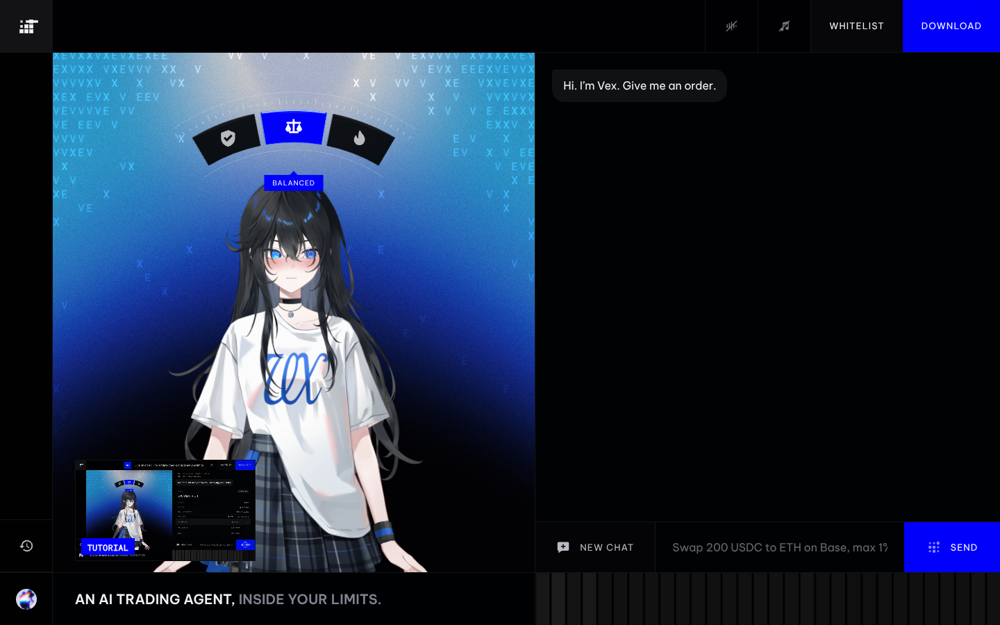

# VEX home (projectvex.ai rebuild)

One screen: Kimm, the Live2D face of Vex, on the left; a chat with Vex on the right; the history rail on the far left; the dial menu behind the grid key, with the full design system inside it. Version 99.



## Start here

| If you are | Read |
|---|---|
| Engineering | [`docs/HANDOFF.md`](docs/HANDOFF.md): run, build, file map, APIs, order flow, how to connect the real runtime |
| Design | [`docs/DESIGN-SYSTEM.md`](docs/DESIGN-SYSTEM.md) and [`docs/DESIGN-RULES.md`](docs/DESIGN-RULES.md); tokens as code in [`docs/tokens.css`](docs/tokens.css) / [`docs/tokens.json`](docs/tokens.json) |
| Content | [`docs/COPY.md`](docs/COPY.md): how Vex speaks, every line and scenario |
| Character / sound | [`docs/KIMM.md`](docs/KIMM.md), [`docs/MUSIC.md`](docs/MUSIC.md) |

The design system is also live in the page: menu → **Design system** (or open `index.html#ds-colour`).

## Run it

```
cd dist
python3 -m http.server 8000     # open http://localhost:8000
```

Serve over http, not as a file (Kimm's model is fetched at runtime). Libraries are in `dist/lib`, so it works offline. Sound starts after the first click or key press.

## Rebuild after editing `src/`

```
python3 build.py          # local libraries (dist/lib)
python3 build.py --cdn    # libraries from jsdelivr, as in the published preview
```

## What is in the package

| Folder | Contents |
|---|---|
| `dist/` | the built page, ready to serve |
| `src/` | source: template, styles, scripts, fonts, Hairline figures |
| `docs/` | handoff, design system, design rules, copy, tokens, Kimm and music notes, changelog |
| `assets/brand/` | the VEX mark (SVG, light and dark) |
| `assets/icons/` | every glyph as SVG (24px grid, `currentColor`) |
| `assets/kimm-states/` | Kimm's six moods as transparent PNGs |
| `assets/screens/` | screenshots of every state, each design system chapter, mobile and 2560 wide |
| `model/`, `model-source/` | Kimm's Live2D model for the web, and the original as delivered |
| `voice/` | Vex's recorded lines, their text, the render scripts |
| `music/` | the night-drive loop and the tool that renders it |
| `reel/` | the Tutorial video |

## Licences to note

- Kimm (Live2D model) and Vex's voice lines belong to VEX Labs.
- `src/gradient-ascii.js` is a port of React Bits Gradient ASCII (MIT + Commons Clause, David Haz).
- GSAP and its plugins (free), PIXI.js (MIT), pixi-live2d-display (MIT), Live2D Cubism Core (Live2D Proprietary Software License: check its terms before a commercial release).
- Be Vietnam Pro and Roboto Mono: SIL Open Font License.
